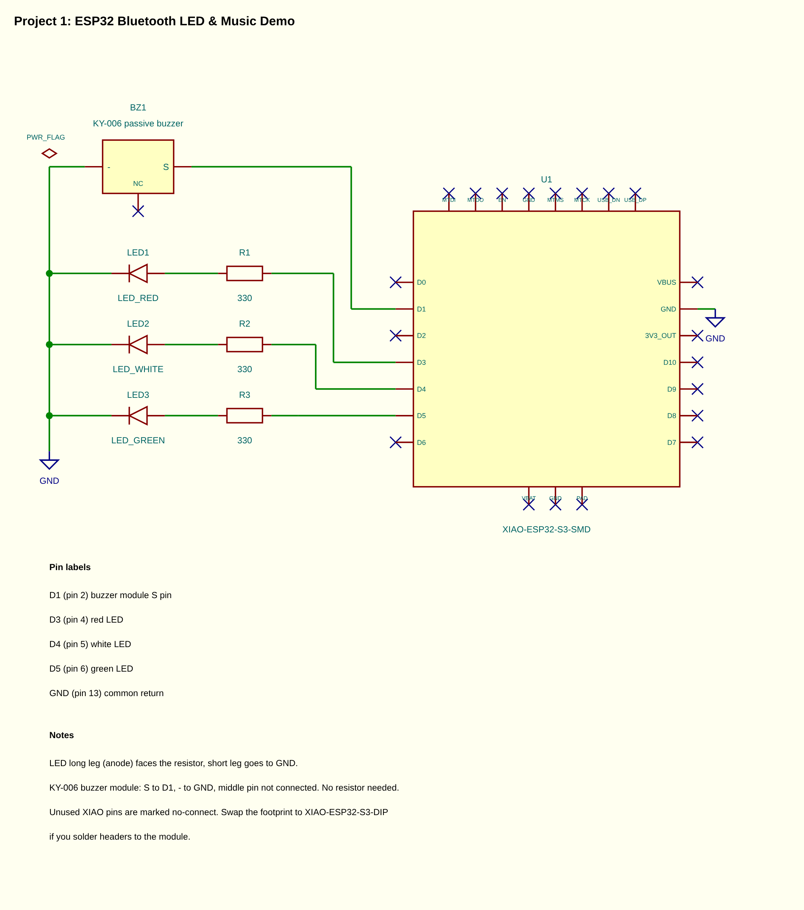

## Project 1: ESP32 Bluetooth LED & Music Demo

This is the classic "blink an LED" project with one change: you control the LEDs from a computer or phone over Bluetooth. A web app talks to a Seeed Studio XIAO ESP32 using Bluetooth Low Energy (BLE). From the app you can switch three LEDs on and off, run light patterns, and play a song on a buzzer while the LEDs flash with the notes.

The app runs in Chrome on a computer, and you can also push it to an Android phone.



### Why this project

The lab's prosthesis project needs an ESP32 that reads muscle signals and moves a hand. This project covers the basics you'll need for that: programming a microcontroller in the Arduino IDE, wiring LEDs and a buzzer, sending commands over BLE, and writing firmware that never blocks (it times things with `millis()` instead of `delay()`). You'll also build a small app that talks to hardware and use Git and GitHub along the way.

### What you need

| Part | Notes |
|------|-------|
| Seeed Studio XIAO ESP32 (S3, C3 or C6) | Tested on the S3 |
| 1 red, 1 white and 1 green LED | 3 mm or 5 mm |
| 3 resistors, 330 ohm | One per LED |
| 1 passive buzzer module (KY-006 or similar) | Must be passive. See the buzzer notes in Step 1. |
| Breadboard and jumper wires | |
| USB-C data cable | Some cables only charge and won't work |

The full list, with schematic references and footprints, is in [`project-1-ble-led/docs/bill_of_materials.csv`](project-1-ble-led/docs/bill_of_materials.csv). The software you need is covered in the environment setup above. For the Android option you also need Android Studio and a phone with Developer options and USB debugging turned on.

### Step 1: Wire it up

Each LED follows the same path: board pin, 330 ohm resistor, LED long leg, LED short leg, GND.

| Part | Connects to |
|------|-------------|
| Red LED (through a resistor) | D3 |
| White LED (through a resistor) | D4 |
| Green LED (through a resistor) | D5 |
| Buzzer module, S pin | D1 |
| Buzzer module, - pin | GND |
| All LED short legs | GND |

The middle pin on the buzzer module isn't used, so leave it unconnected. The pin markings are small, so check them on your own module. These pin names work on the XIAO ESP32-C3, -S3 and -C6. The KiCad schematic is covered under [Schematic](#schematic).

**Buzzer notes**

- A **passive** buzzer can play different notes, and that's the one the sketch is written for. A module like the KY-006 doesn't need a resistor. If you use a bare speaker instead, put a resistor of at least 220 ohm in series with it.
- An **active** buzzer only makes one fixed beep, so it won't play the song correctly.
- If you're not sure which type you have, touch the + leg to 3V3 and the other leg to GND. A steady tone means it's active. A single click means it's passive.

### Step 2: Flash the ESP32

1. If you haven't already, install **esp32 by Espressif Systems** in the Arduino IDE's Boards Manager.
2. Open `project-1-ble-led/firmware/led_ble/led_ble.ino` with File > Open. The file has to stay inside a folder called `led_ble`.
3. Pick your board under Tools > Board > esp32. Choose the XIAO entry that matches your board, like `XIAO_ESP32S3`. A generic ESP32 board won't compile, because the pin names `D1`, `D3`, `D4` and `D5` only exist on XIAO boards.
4. On the XIAO ESP32-S3, set Tools > USB CDC On Boot to **Enabled** if you want Serial Monitor output.
5. Pick the port under Tools > Port and click Upload.
6. Open the Serial Monitor at 115200 baud. You should see `Advertising as XIAO-LED`.

If no port shows up, hold the BOOT button while you plug in the USB cable, then let go.

On the S3, the upload can end with `A device which does not exist was specified` or `Failed uploading`, even when every step above it says `Hash of data verified`. The USB port drops out for a moment when the board resets, and the upload tool loses track of it. The upload worked, so select the port again and carry on.

### Step 3: Run the app in Chrome

```bash
cd project-1-ble-led/app
npm install
npm run dev
```

Open http://localhost:5173 in Chrome or Edge and click **Connect to XIAO-LED**.

Web Bluetooth only works on `localhost` or HTTPS, so an address like `http://192.168.1.20:5173` won't work. The board accepts one connection at a time, so make sure nothing else is connected to it.

### Step 4: Run it on an Android phone

Install Android Studio, then turn on Developer options and USB debugging on the phone. From the `project-1-ble-led/app` folder, run:

```bash
npm install
npx cap add android      # first time only
npm run android:sync     # builds the app and copies it into the Android project
npm run android:open     # opens Android Studio, then press Run with the phone plugged in
```

After you change any app code, run `npm run android:sync` again. The first time you connect, Android asks for the "Nearby devices" permission, so allow it.

On Windows, run each command on its own from inside the `app` folder, the one that has `package.json` in it. If the project is in a OneDrive folder and you get strange file errors, copy it to a plain folder like `C:\dev` first.

### How it works

```
Chrome or Android app  <--- BLE --->  XIAO ESP32  --->  LEDs and buzzer
```

The ESP32 advertises itself as `XIAO-LED`. It has one BLE service with two characteristics, one for the LED state and one for the pattern. The app connects, reads the current state, and writes to those characteristics when you flip a toggle, pick a pattern or press Play.

The firmware loop never waits. Patterns and the song move forward on `millis()` timers, so BLE keeps responding while the lights and sound run.

BLE callbacks run in a different task from `loop()`. That's why the shared variables are `volatile`, and why the callbacks only set values and flags. The real work happens in `loop()`.

In the app, Bluetooth calls go through a queue, because BLE only allows one operation at a time. While the song plays, the app checks the board once a second so the Play button resets when the song ends.

### BLE reference

| Item | UUID | Access | Format |
|------|------|--------|--------|
| Service | `4fafc201-1fb5-459e-8fcc-c5c9c331914b` | | |
| LED state | `beb5483e-36e1-4688-b7f5-ea07361b26a8` | read, write | 3 bytes `[red, white, green]`, each 0 or 1 |
| Pattern | `1c95d5e3-d8f7-413a-bf3d-7a2e5d7be87e` | read, write | 2 bytes `[pattern, speed]` |

The patterns are `0` manual, `1` blink all, `2` chase, `3` alternate and `4` play the song. Speed is the step time in units of 10 ms, so 50 means 500 ms. Writing one byte sets only the pattern.

Writing the LED state puts the board back in manual mode and stops the music. When the song finishes, the board goes back to pattern 0 on its own.

If you change a UUID, change it in both `led_ble.ino` and `app/src/ble.ts`. Keep the UUIDs lowercase, because the Android plugin is case sensitive.

### Schematic

The KiCad schematic is `project-1-ble-led/docs/kicad/led_ble.kicad_sch`. Open `led_ble.kicad_pro` in KiCad 9 or newer. The project loads the XIAO symbol and footprints from the `lib/` folder, so there's nothing to install. A picture of the schematic is next to it as `led_ble_schematic_preview.png`.

- **XIAO ESP32-S3:** uses Seeed Studio's own symbol and footprint. The footprint is the SMD one (`XIAO-ESP32-S3-SMD`). If you solder headers onto the module, change it to `XIAO-ESP32-S3-DIP`.
- **Buzzer:** the KY-006 passive buzzer module, a 3-pin board with pin 1 `-`, pin 2 unused and pin 3 `S`. The footprint is KiCad's standard 3-pin header, `PinHeader_1x03_P2.54mm_Vertical`.
- **LEDs and resistors:** simple symbols with through-hole footprints.
- **Unused XIAO pins:** marked no-connect.

This is a wiring schematic only, so there's no PCB layout.

### Changing things

**Settings.** These are at the top of `led_ble.ino`:

| Setting | What it does |
|---------|--------------|
| `DEVICE_NAME` | Name shown in the Bluetooth picker |
| `LED_PINS` | Pins for red, white and green |
| `SPEAKER_PIN` | Pin for the buzzer (default `D1`) |
| `EIGHTH_MS` | Length of one eighth note in milliseconds. A bigger number is slower. |

**The song.** In `led_ble.ino`, find the `SONG` array. Each entry looks like `{NOTE_E4, 1}`: a note name, then its length in eighth notes (1 is an eighth, 2 a quarter, 4 a half). Use `N_REST` as the note for a pause. The note names are defined just above the array, from `NOTE_C4` to `NOTE_C5`, and `S` means sharp, so `NOTE_DS4` is D#4. To use a note that isn't listed, add a line like `#define NOTE_E5 659`. Change `EIGHTH_MS` to speed the song up or slow it down.

**The app.** The title is `APP_TITLE` in `app/src/ble.ts`. The LED names and colors are in `LED_INFO` in `app/src/App.tsx`.

### Challenges

Once everything works, try these in order:

1. Get all three LEDs switching from the app.
2. Add a new pattern, like a fade or a slow breathe.
3. Add a brightness control using PWM.
4. Have the ESP32 send updates to the app with BLE notifications, so the app doesn't have to check every second.
5. Replace the song with your own, or add a second song and a way to choose between them.
6. Read a potentiometer on an ADC pin and show the value live in the app. This is a first step toward reading EMG signals.

### Troubleshooting

#### Quick fixes

| Problem | Fix |
|---------|-----|
| `'D3' was not declared` when compiling | The wrong board is selected. Pick your XIAO board under Tools > Board. |
| `exit status 1` and nothing else | Turn on File > Preferences > Show verbose output during compilation, then look for lines that contain `error:`. |
| `A device which does not exist was specified` after upload | Usually harmless on the S3 (see Step 2). Select the port again. |
| `Could not open COM4, the port is busy` | Something else has the port open. Close the Serial Monitor tab and any other serial program, then upload again. If that doesn't work, see Upload problems below. |
| `User cancelled the requestDevice() chooser` | The Bluetooth picker was closed without picking a device. Click Connect, wait for XIAO-LED to appear, click its row, then click Pair. |
| An LED never lights | Check the polarity (long leg toward the resistor and pin), the resistor, and that the wire is in the right hole. |
| The buzzer is silent | Check that the buzzer is a passive one. Make sure the S pin goes to D1 and the - pin goes to GND. |
| The Android app still acts like the old version | Run `npm run android:sync` again, then press Run in Android Studio. |
| `npm` can't find `package.json` | You're in the wrong folder. Run `dir` (Windows) or `ls`, then `cd` into `app`. |
| OneDrive asks "Delete these items?" during `npm install` | Click **Keep**. It's the `node_modules` folder being rewritten. It's better to keep the project in a normal folder like `C:\dev` instead of OneDrive. |

#### Bluetooth connection problems

Work through these in order, and stop once it connects.

1. **Check that the board is advertising.** Open the Serial Monitor at 115200 baud and press the board's reset button. You should see `Advertising as XIAO-LED`. If you see nothing, upload the sketch again.
2. **Close anything else that's connected to the board.** It only accepts one connection at a time. Close other Chrome tabs running the app, and close nRF Connect or any other Bluetooth app on your phone.
3. **Use the picker carefully.** Click Connect, wait a few seconds for the scan, click the **XIAO-LED** row so it's highlighted, then click **Pair**. The Pair button stays grey until a row is selected.
4. **"No compatible devices found."** Click Re-scan. If the board still doesn't show up, go to step 6.
5. **The connection fails or times out.** Windows may be holding an old record of the board.
   - Open Settings > Bluetooth & devices and remove any XIAO-LED entry.
   - Press Win+R, type `control printers`, press Enter, and remove XIAO-LED there if it's listed. Ignore "USB JTAG/serial debug unit". That's the USB connection, not Bluetooth.
   - Turn Bluetooth off and on, close every Chrome window, press the board's reset button, and try again.
6. **Check whether another device can see the board.** Install **nRF Connect** on a phone, scan, and look for `XIAO-LED`.
   - If the phone can connect, the board is fine and the problem is the computer's Bluetooth or Chrome. Go to step 7.
   - If the phone can't see it, the problem is the board. Go to step 8.
7. **Computer side.**
   - Open `chrome://bluetooth-internals`, click Start Scan, and see if XIAO-LED appears.
   - Make sure Bluetooth is on in Windows settings, and restart the **Bluetooth Support Service** in `services.msc`.
   - Update or reinstall the Bluetooth driver in Device Manager. Some desktop adapters can't scan for BLE at all.
   - Try Edge, another computer or the Android app.
8. **Board side.**
   - Attach the antenna. The XIAO ESP32-S3 has a small connector next to the USB port for it, and the signal is very weak without it.
   - Unplug everything from the pins (LEDs, resistors, buzzer) and leave only the USB cable. A wiring mistake or a short can pull the supply down and make the radio unreliable.
   - Hold the phone right next to the board.
   - Upload Espressif's example (File > Examples > ESP32 > BLE > Server) and scan for `ESP32`. If that shows up but this sketch doesn't, the problem is in the sketch. If neither shows up, the problem is the board or its power.
   - Erase the chip's flash (see Upload problems below), then upload the sketch again.

#### Upload problems

- **Port busy or not found.** Close the Serial Monitor. Unplug the USB cable, hold the **BOOT** button, plug the cable back in, and let go of BOOT. Select the port again under Tools > Port, then click Upload.
- **Erasing the flash.** In the Arduino IDE, set Tools > **Erase All Flash Before Sketch Upload** to Enabled and upload. Then set it back to Disabled. This clears old Bluetooth data stored on the chip.
- **Wrong board.** The Output pane shows the board name, for example `XIAO_ESP32S3`. If it says `esp32_family` or some other board, pick your XIAO under Tools > Board.

### Status

Tested on a XIAO ESP32-S3 with Chrome. That covered connecting, the LED toggles, the patterns, and the music on a passive buzzer. The Android app builds and syncs but hasn't been tested much.

## Contact

Robert Haas, George Mason University.
